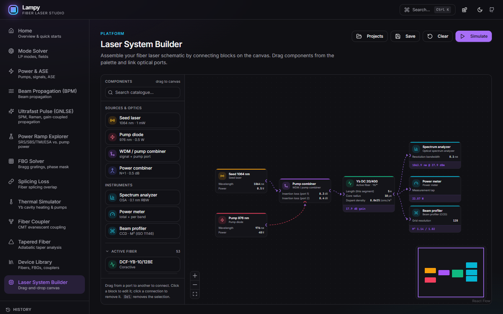
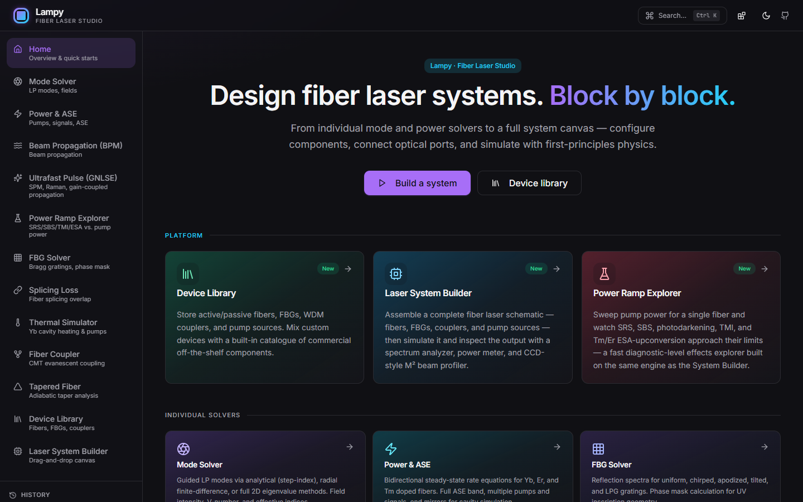
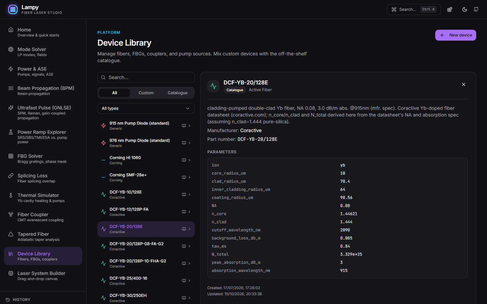
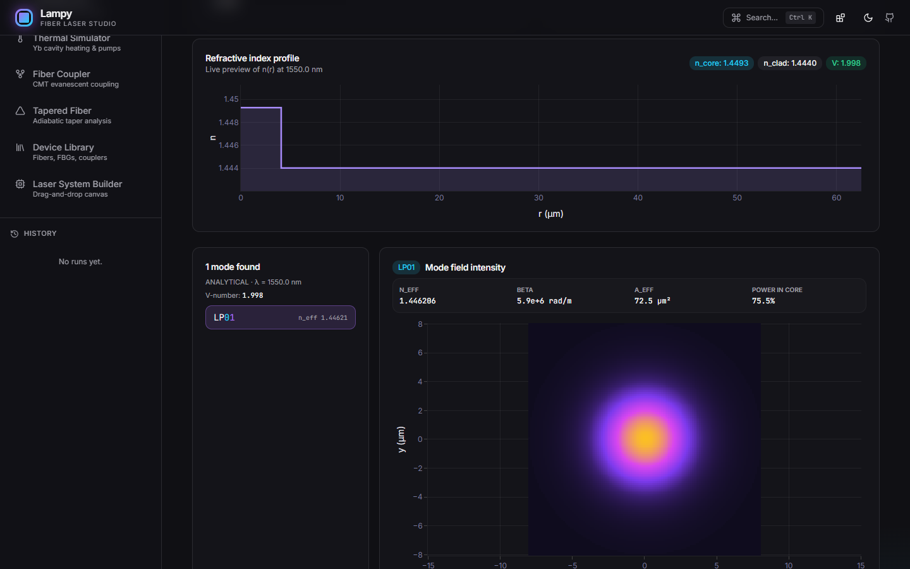
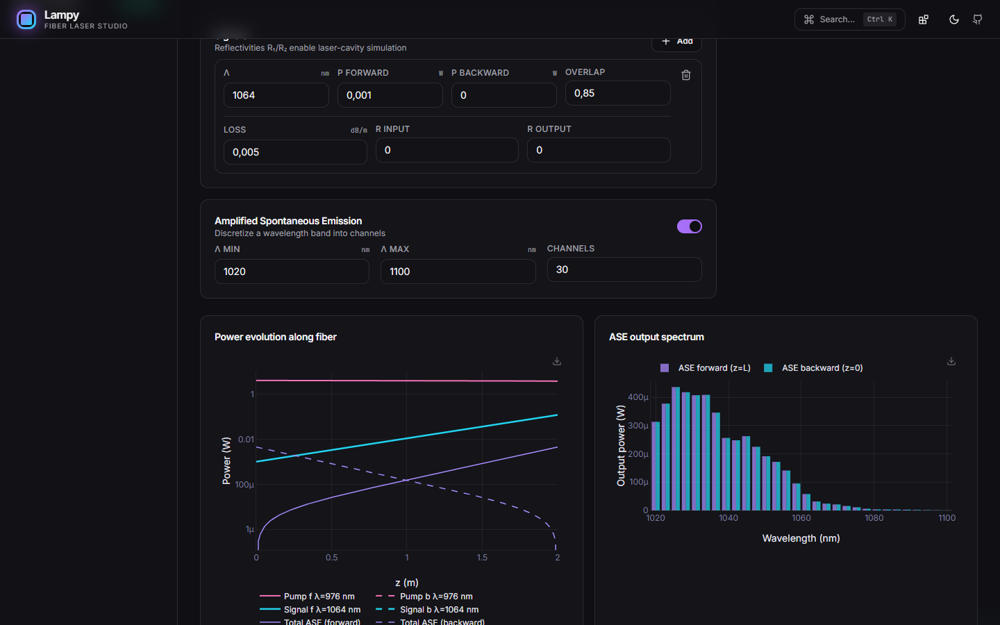
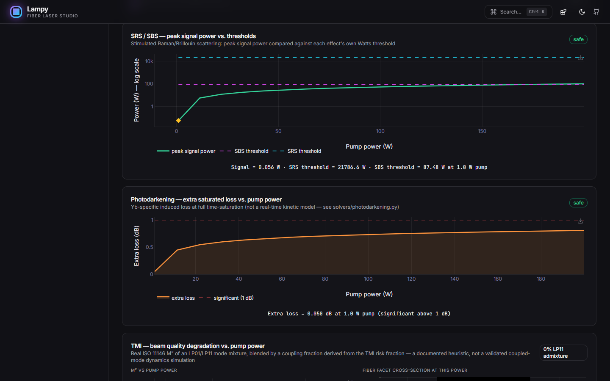
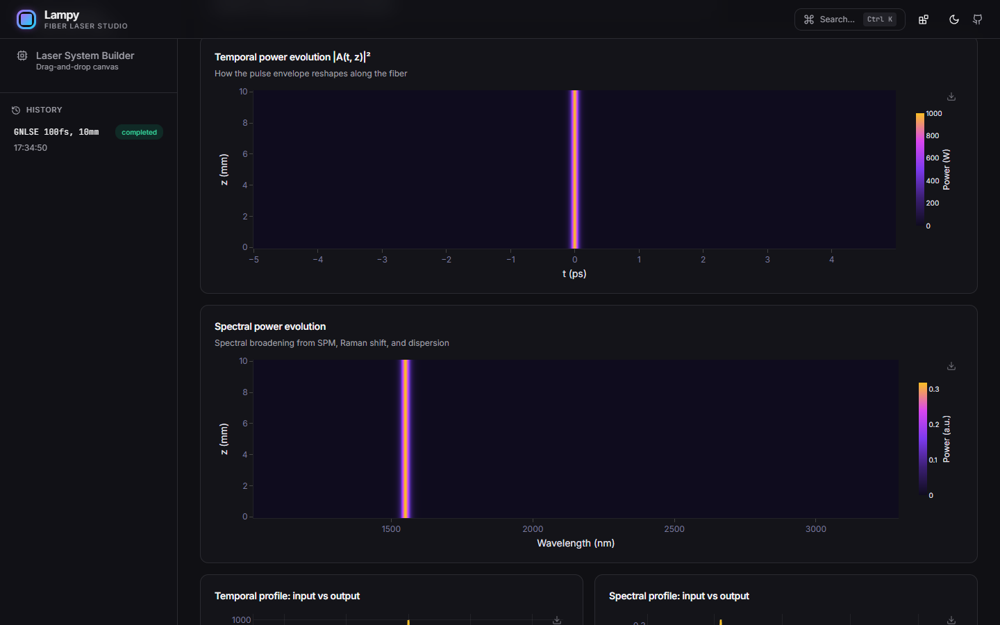
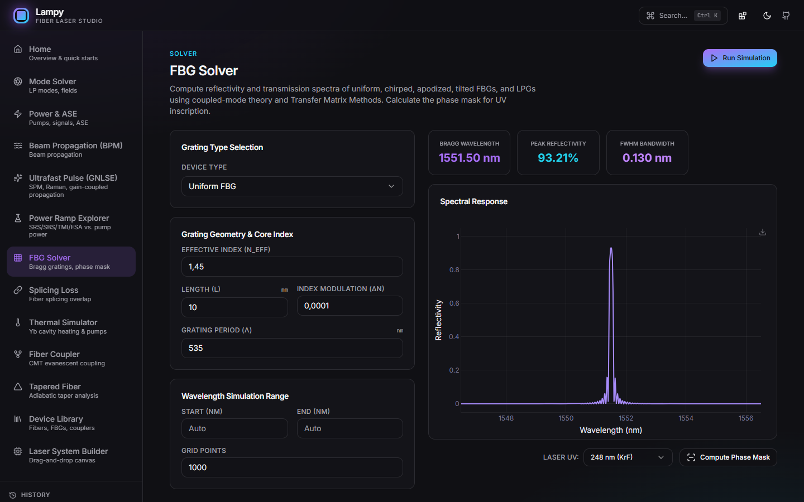
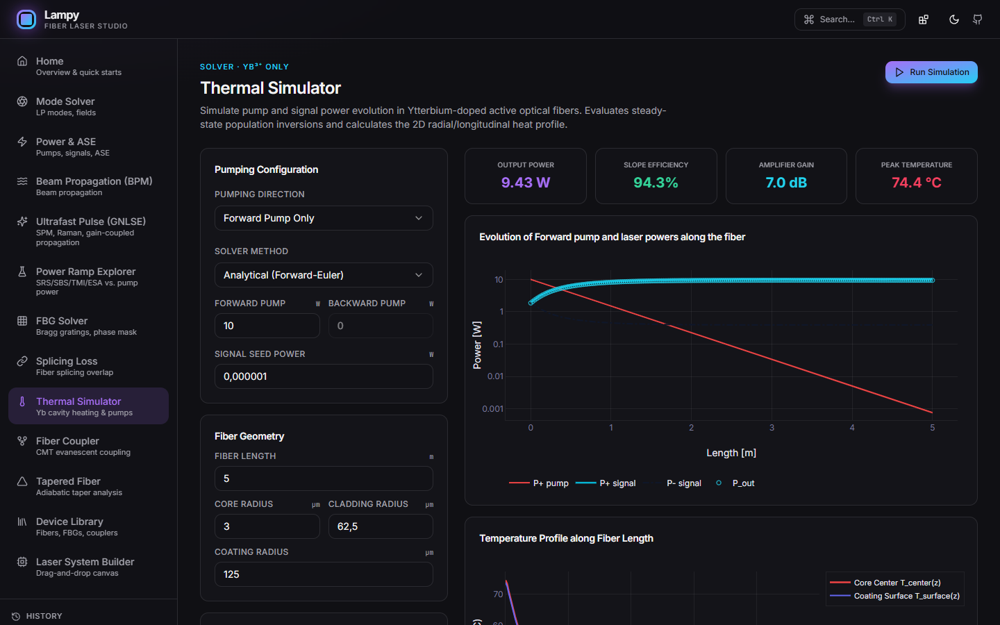

# Lampy — Fiber Laser Studio

A professional-grade platform for designing and simulating high-power fiber laser systems — from individual component solvers to a fully simulated visual system builder with virtual bench instruments.

Built on top of the **fibersim** Python physics library (inspired by RP Fiber Power), with a FastAPI backend and a React + TypeScript UI.



<p align="center"><sub>Laser System Builder: seed + 976 nm pump → combiner → double-clad Yb fiber, simulated end to end. Each instrument node shows its live reading (OSA peak, output power, M²).</sub></p>

---

## Screenshots

| | |
|:---:|:---:|
|  |  |
| **Home** — every tool one click (or one `G`-chord) away | **Device Library** — 61 shelf devices, incl. 53 real Yb/Er/Tm fiber SKUs |
|  |  |
| **Mode Solver** — LP-mode list, n_eff, A_eff and field intensity | **Power & ASE** — z-resolved pump/signal/ASE and the output ASE spectrum |
|  |  |
| **Power Ramp Explorer** — SRS/SBS, photodarkening and TMI vs. pump power | **Ultrafast Pulse (GNLSE)** — temporal and spectral evolution along z |
|  |  |
| **FBG Solver** — reflection spectrum, Bragg λ, peak R and FWHM | **Thermal Simulator** — Yb cavity powers and core/surface temperature |

Screenshots are generated by [`scripts/capture_screenshots.py`](scripts/capture_screenshots.py) — see [Regenerating the screenshots](#regenerating-the-screenshots).

---

## What you can do

### Individual solvers
| Page | Description |
|---|---|
| **Mode Solver** | Guided LP modes via analytical (step-index), radial FD (sweeps every azimuthal order ℓ automatically), or full 2D eigenvalue methods. Field intensity, V-number, effective indices. Load a fiber straight from the **Device Library** catalogue to analyze its real modes. |
| **Power & ASE** | Bidirectional steady-state rate equations for Yb, Er, Tm fibers. Multiple pumps/signals with a per-channel overlap Γ, full ASE band, end mirrors for cavity simulation. (The automatic, mode-solved Γ lives in the Laser System Builder and Power Ramp Explorer.) |
| **FBG Solver** | Reflection spectra for uniform, chirped, apodized, tilted gratings and LPGs. Phase mask calculation for UV inscription geometry. |
| **BPM** | Paraxial split-step Fourier BPM in 3D. Tilt/misalign the launch, observe coupling efficiency and beat patterns. |
| **Fiber Coupler** | Directional coupler via coupled-mode theory (CMT) — evanescent coupling between two parallel fibers over a coupling length. |
| **Tapered Fiber** | Biconical taper local-mode (adiabatic) analysis — down-taper, waist, up-taper, with adiabaticity criterion. |
| **Thermal Simulator** | **Yb³⁺ only** (port of a Yb MATLAB reference). 3-layer heat conduction (core / cladding / coating) coupled to the longitudinal power and gain profile, with a circular cross-section temperature view. |
| **Splicing Loss** | Splice loss via field overlap integral — lateral, angular, and waist misalignment. |
| **Ultrafast Pulse (GNLSE)** | Generalized nonlinear Schrödinger equation propagation — SPM, Raman, self-steepening, higher-order dispersion, with an optional gain-coupled mode for amplifier simulation (saturating, Lorentzian gain-bandwidth filter). Time/spectral evolution heatmaps, input/output comparison. |
| **Power Ramp Explorer** | Sweeps pump power for a single fiber and shows, with the physically appropriate analysis for each: SRS/SBS peak signal power vs. their own Watts thresholds, photodarkening extra loss (dB), a real ISO 11146 M² degradation curve *and* an interactive LP01/LP11 fiber-facet cross-section for TMI, and Tm cross-relaxation yield / Er upconversion activity. Inapplicable effects (e.g. TMI on a single-mode fiber) are shown as an explicit "N/A — reason", never silently omitted. |

### Platform
| Feature | Description |
|---|---|
| **Device Library** | Store and manage active/passive fibers, FBGs, WDM couplers, and pump sources. Built-in catalogue of **61 shelf devices**, including **53 real rare-earth-doped fiber SKUs** (44 Yb, 8 Er, 1 Tm) transcribed from nLIGHT LIEKKI, Coractive, YOEC, Nufern and OFS datasheets — each with `N_total`/`n_core`/`n_clad` derived physically from the manufacturer's stated NA and absorption at the datasheet's own wavelength (not guessed), verified to guide a sane fundamental mode. Mix shelf and custom devices, backed by a local SQLite database with idempotent seeding (new catalogue additions reach existing installs automatically). |
| **Laser System Builder** | Visual drag-and-drop canvas to assemble complete fiber laser schematics — fibers, FBGs, WDM couplers, power combiners, and pump sources — and **actually simulate them**. The engine walks the typed circuit graph, auto-detects FBG-FBG laser cavities, chains multi-stage MOPAs, and computes automatic modal overlap (Γ) instead of a manual scalar. Configurable sidebar of component "packages" so you only see what you use. |
| **Virtual bench instruments** | Drop an **OSA** (spectrum, configurable RBW), **Power Meter** (total + per-band), or **CCD Beam Profiler** (M² per ISO 11146, camera image, cross-sections, caustic) onto any point in the circuit. |
| **Nonlinear-effects diagnostics** | Every active fiber reports SRS/SBS threshold proximity, Yb photodarkening (saturated extra loss estimate), Tm cross-relaxation / Er cooperative-upconversion, and TMI risk — surfaced both per-node and in a dedicated **"Nonlinear effects"** tab in Simulation Results, so you don't have to click each fiber individually to see them. |

---

## Quick start

### 1. Backend (Python ≥ 3.10)

```bash
# from the project root
pip install -e ".[backend,dev]"
uvicorn backend.app.main:app --reload
```

The API is available at <http://127.0.0.1:8000> with interactive docs at <http://127.0.0.1:8000/docs>.

On first startup, the backend creates `devices.db` (SQLite) and seeds it with the off-the-shelf device catalogue automatically. Seeding is idempotent by device name, so pulling in new catalogue additions later doesn't require deleting the database.

### 2. Frontend

```bash
cd frontend
npm install
npm run dev
```

Open <http://localhost:5173>. Vite proxies `/api` and `/ws` to the FastAPI server on port 8000.

> **Port 8000 taken?** Run the API on another port and point Vite at it:
> `uvicorn backend.app.main:app --port 8765` and `LAMPY_API_URL=http://127.0.0.1:8765 npm run dev`.
> `.claude/launch.json` has `backend-alt` / `frontend-alt` configs that do exactly this.

### 3. One-click on Windows

Double-click **`run.bat`**: it creates the venv, installs the Python deps, builds the frontend (and **rebuilds it whenever `frontend/src` changed** since the last build), then serves everything on <http://localhost:8000>.

> <http://localhost:8000> serves the *built* UI from `frontend/dist/`. During development use the Vite server on <http://localhost:5173>, which hot-reloads — an old `dist/` build is the usual reason the :8000 UI looks out of date.

### 4. One-shot dev (with `just`)

```bash
just install      # Python + JS deps
just dev          # uvicorn + vite in parallel
```

### 5. Tests

```bash
python -m pytest tests -q
```

~180 tests covering golden-value physics checks, cross-solver validation (e.g. `solve_ase` vs. the legacy MATLAB-ported cavity solver), and full backend API round-trips.

---

## Architecture

```
software-lamp/
├── src/fibersim/              Physics library (pure Python)
│   ├── core/                  Fiber geometry, materials (Sellmeier), active ions
│   │                          (Yb/Er McCumber-derived spectra, Tm 790nm pump band)
│   ├── solvers/
│   │   ├── modes/             Analytical, radial FD, full 2D eigenvalue
│   │   ├── power/              Bidirectional steady-state ASE (auto-Γ, quantum-yield
│   │   │                       pumping, cooperative-upconversion quenching), dynamic rate eqs.
│   │   ├── fbg/                TMM: uniform, chirped, apodized, tilted, LPG, phase mask
│   │   ├── propagation/        Split-step Fourier BPM + GNLSE (with gain coupling)
│   │   ├── coupler/            CMT directional coupler
│   │   ├── taper/              Adiabatic local-mode taper analysis
│   │   ├── thermal/            3-layer cylindrical heat conduction (legacy MATLAB port)
│   │   ├── splicing/           Field overlap integral
│   │   ├── nonlinear_thresholds.py   SRS/SBS threshold estimators (Smith 1972)
│   │   └── photodarkening.py         Yb photodarkening saturated-loss estimator
│   │
│   └── system/                 Laser System Builder engine
│       ├── graph.py             Typed circuit graph, validation, cavity/MOPA detection
│       ├── signal.py            Spectral channel representation (pump/signal/ASE)
│       ├── engine.py            Orchestrates solvers across the graph; nonlinear diagnostics
│       ├── overlap.py           Automatic modal-overlap Γ (mode×dopant, cladding-pump ratio)
│       ├── beam.py               M² beam-profiler analysis (ISO 11146) + LP01/LP11 mixing
│       ├── instruments.py        OSA / power-meter instrument models
│       ├── thermal_lensing.py    dn/dT-perturbed mode re-solve
│       └── tmi_threshold.py      TMI risk-fraction estimator
│
├── backend/app/
│   ├── main.py                 FastAPI app — CORS, GZip, router registration, DB init
│   ├── config.py               Pydantic-settings (CORS origins, etc.)
│   ├── database.py             SQLAlchemy engine + session (SQLite: devices.db)
│   ├── models/                 Device, System ORM models
│   ├── schemas/                Pydantic request/response models
│   ├── routers/                /api/modes    /api/power     /api/bpm    /api/fbg
│   │                           /api/thermal  /api/splicing  /api/coupler /api/taper
│   │                           /api/devices  /api/jobs      /api/system  /api/systems
│   │                           /api/gnlse    /api/power-ramp /api/fibers  /health
│   ├── services/               Fiber builder, base64 encoders, solver runners,
│   │                           system-graph adapter, power-ramp sweep runner
│   ├── jobs.py                 In-memory JobManager (semaphore, TTL, cancel)
│   └── ws.py                   WebSocket /ws/jobs/{job_id}
│
├── scripts/
│   └── capture_screenshots.py  Regenerates docs/images/*.png (headless Edge/Chrome via CDP)
│
└── frontend/src/
    ├── pages/                  HomePage, ModeSolverPage, PowerSimPage, BPMPage,
    │                           FBGPage, ThermalPage, SplicingPage, CouplerPage, TaperPage,
    │                           DeviceLibraryPage, SystemBuilderPage, GNLSEPage, PowerRampPage
    ├── components/             ui/ (shadcn), layout/, fiber/ (incl. catalog picker),
    │                           instruments/ (OSA/PowerMeter/BeamProfiler panels), plots/, jobs/
    ├── lib/                    api.ts, ws.ts, encoding.ts
    ├── stores/                 Zustand: theme, jobs, fiber, nav-package prefs
    └── types/                  TS mirrors of Pydantic schemas + device/system/gnlse/power-ramp types
```

### Device Library — data model

```
Device
  id            UUID (primary key)
  name          string
  description   text
  device_type   fiber_active | fiber_passive | fbg | coupler_wdm | pump_source
  category      custom | shelf
  manufacturer  string
  part_number   string
  parameters    JSON (type-specific fields)
  created_at    datetime (UTC)
  updated_at    datetime (UTC)
```

**Shelf catalogue** (61 devices, seeded automatically on first run, idempotent by name):
- **44 Yb-doped active fibers**: 23 nLIGHT LIEKKI (core- and cladding-pumped, single-, double-, and triple-clad HELMI/PM variants), 15 Coractive (DCF-YB series + YB1xx/4xx single-clad), 4 YOEC (YDF/YTF series), 2 Nufern (SM-YSF-HI, LMA-YDF-10/125-M)
- **8 Er-doped active fibers** (Coractive EDF-L 1500, ER12-6, ER35-7, ER8-6, SCF-ER series) and **1 Tm-doped** (OFS RightWave TmDF200) — all core-pumped, single-clad
- Corning HI 1060, SMF-28e+ (passive fibers)
- 976 nm / 915 nm pump diodes
- WDM 976/1064 nm, WDM 976/1550 nm couplers
- FBG HR 1064 nm (R = 99%), FBG OC 1064 nm (R = 10%)

Absorption is stored as `peak_absorption_dB_m` + `absorption_wavelength_nm` — 915/920 nm cladding absorption for most Yb double-clad fibers, 976 nm core absorption for the Nufern ones, 1530/1535 nm for Er, 790 nm for Tm. Databases created with the legacy `peak_absorption_dB_m_976nm` key are migrated automatically at startup.

Each catalogue fiber's `N_total` (dopant density) and `n_core`/`n_clad` are derived from the manufacturer's published NA and pump absorption spec via the ion's real absorption cross-section (McCumber-derived) and the actual computed modal/cladding overlap Γ — not hand-tuned — and every entry is verified to guide a physically sane fundamental mode.

### Job protocol (long-running solvers)

```
POST /api/power/ase        {request}   →  { job_id, status: queued }
POST /api/system/simulate  {graph}     →  { job_id, status: queued }
POST /api/gnlse            {request}   →  { job_id, status: queued }
POST /api/power-ramp       {request}   →  { job_id, status: queued }
WS   /ws/jobs/{job_id}                 →  { type: 'progress', value: 0.42 } *
                                        →  { type: 'result',   data: {...} }
POST /api/jobs/{job_id}/cancel
GET  /api/jobs/{job_id}/result          (polling fallback)
```

Progress events are throttled to ~10 Hz on the server side.

---

## UX shortcuts

| Shortcut | Action |
|---|---|
| `Ctrl/⌘ + K` | Open command palette |
| `Ctrl/⌘ + Enter` | Run the simulation (Mode Solver, Power & ASE, BPM, GNLSE, Power Ramp) |
| `G`, then a letter | Go to a page — **H** Home · **M** Mode Solver · **P** Power & ASE · **B** BPM · **U** GNLSE · **R** Power Ramp · **F** FBG · **S** Splicing · **T** Thermal · **C** Coupler · **A** Taper · **D** Device Library · **L** Laser System Builder (also shown in the command palette) |
| `Delete` / `Backspace` | Remove selected node in System Builder |

---

## Regenerating the screenshots

With the backend and frontend dev servers running:

```bash
python scripts/capture_screenshots.py                                   # against http://localhost:5173
python scripts/capture_screenshots.py --url http://localhost:5174 --only system power
```

The script drives the locally installed Edge or Chrome headless over the DevTools protocol — no extra downloads, it only needs `websockets` (already a backend dependency). It seeds a demo MOPA into the System Builder, clicks each page's run button, waits for the result and writes `docs/images/<page>.png` at 1440×900 in the dark theme.

---

## Using `fibersim` directly (no UI)

The physics library is fully usable from scripts and notebooks:

```python
from fibersim.core.fiber import StepIndexFiber
from fibersim.core.materials import Silica, Germanosilicate
from fibersim.solvers.modes.analytical import find_modes

fiber = StepIndexFiber(
    core_radius=4e-6,
    cladding_radius=62.5e-6,
    core_material=Germanosilicate(0.035),
    cladding_material=Silica(),
)
modes = find_modes(fiber.core_radius, n_core=1.4485, n_cladding=1.444, wavelength=1.55e-6)
print(f"Found {len(modes)} guided modes")
```

```python
from fibersim.solvers.fbg.solver import calculate_phase_mask

result = calculate_phase_mask(
    grating_type="uniform",
    n_eff=1.45,
    length_mm=10.0,
    dn=5e-4,
    period_nm=535.0,
    lambda_uv_nm=248.0,
)
print(f"Phase mask period: {result['params']['period_pm_center_nm']:.2f} nm")
print(f"Diffraction angle: {result['params']['diffraction_angle_deg']:.2f}°")
```

Building and simulating a full laser system programmatically:

```python
from fibersim.system import SystemGraph, SystemNode, SystemEdge, simulate_system

nodes = [
    SystemNode(id="pump", kind="pump_source", params={"wavelength_nm": 976.0, "power_w": 50.0}),
    SystemNode(id="seed", kind="seed", params={"wavelength_nm": 1064.0, "power_w": 0.01}),
    SystemNode(id="wdm", kind="coupler_wdm", params={}),
    SystemNode(id="yb", kind="fiber_active", params={"ion": "yb", "core_radius_um": 5.0,
                                                       "clad_radius_um": 62.5, "n_core": 1.46,
                                                       "n_clad": 1.454, "N_total": 3e25,
                                                       "length_m": 2.0}),
    SystemNode(id="out", kind="power_meter", params={}),
]
edges = [
    SystemEdge(id="e0", source="seed", target="wdm"),
    SystemEdge(id="e1", source="pump", target="wdm", target_port="pump"),
    SystemEdge(id="e2", source="wdm", target="yb"),
    SystemEdge(id="e3", source="yb", target="out"),
]
result = simulate_system(SystemGraph(nodes, edges))
print(result.nodes["yb"]["gain_db"], result.outputs["out"]["total_power_w"])
```

---

## Roadmap

Not yet done — evaluated and explicitly deferred, or waiting on a concrete source:

- [ ] **Er/Yb co-doped fibers** in the Device Library — real catalogue data exists (Coractive), but the simulator only models a single dopant ion per fiber; would need a two-ion energy-transfer rate-equation model.
- [ ] **Real FBG / WDM coupler / pump-diode catalogue parts** — current shelf entries for these are generic, not transcribed manufacturer SKUs (unlike the fiber catalogue), and only cover the Yb band (976/915 nm pumps, 1064 nm FBGs, 976/1064 WDM). Er (980/1480 nm pumps, 1550 nm FBGs) and Tm (793 nm pumps, ~1940 nm FBGs) parts are missing. Needs a concrete product datasheet source per part.
- [ ] Re-check the core radii of EDF-L 1500 and ER35-7 against their datasheets — the derived cutoff (> 2 µm) would make them multimode at 1550 nm (the radius was probably taken from the MFD).
- [ ] Large-mode-area, cladding-pumped Tm fibers in the catalogue — commercially available, but no public datasheet with complete numeric specs found yet.
- [ ] Unify `useFiberStore` usage across Splicing/Thermal/Coupler/Taper pages — each needs a different geometry model (two fibers, thermal-specific fields); doesn't cleanly fit a single "current fiber" store.
- [ ] Pre-submit sanity checks on Modes/Power/BPM/FBG forms (pattern already used on Splicing/Thermal/Coupler/Taper).
- [ ] Fully unify `thermal/cavity.py`'s legacy rate-equation solver with `power/ase.py` — today validated by a cross-check regression test rather than replaced outright (deliberate: `cavity.py` is calibrated against a specific MATLAB reference).
- [ ] Standalone packaging (single-executable launcher via `run.bat` + bundled frontend) — started, parked.
- [ ] Report export (PDF with parameters, plots, and metadata).
- [ ] Run comparison — side-by-side overlay of two simulations from history.

---

## Project status

| Layer | Status |
|---|---|
| `fibersim` physics library | Complete — including auto-Γ, SRS/SBS thresholds, measured ion spectra (McCumber), photodarkening, Tm/Er ESA-upconversion, coupled thermal lensing, TMI risk, GNLSE gain coupling |
| FastAPI backend + REST/WS API | Complete |
| Individual solver UIs | Complete (10 solvers, incl. GNLSE and Power Ramp Explorer) |
| Device Library (SQLite + CRUD UI) | Complete — 61-device shelf catalogue incl. 53 real Yb/Er/Tm fiber SKUs |
| Laser System Builder | Complete — graph engine, cavity/MOPA detection, virtual instruments, nonlinear-effects diagnostics |
| MkDocs documentation | Planned |
